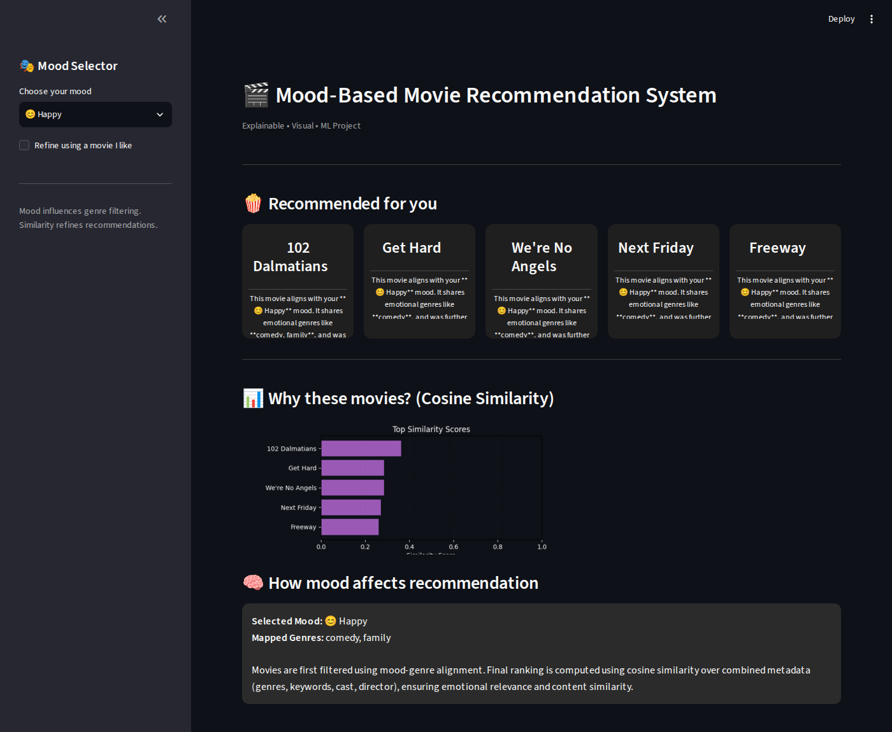
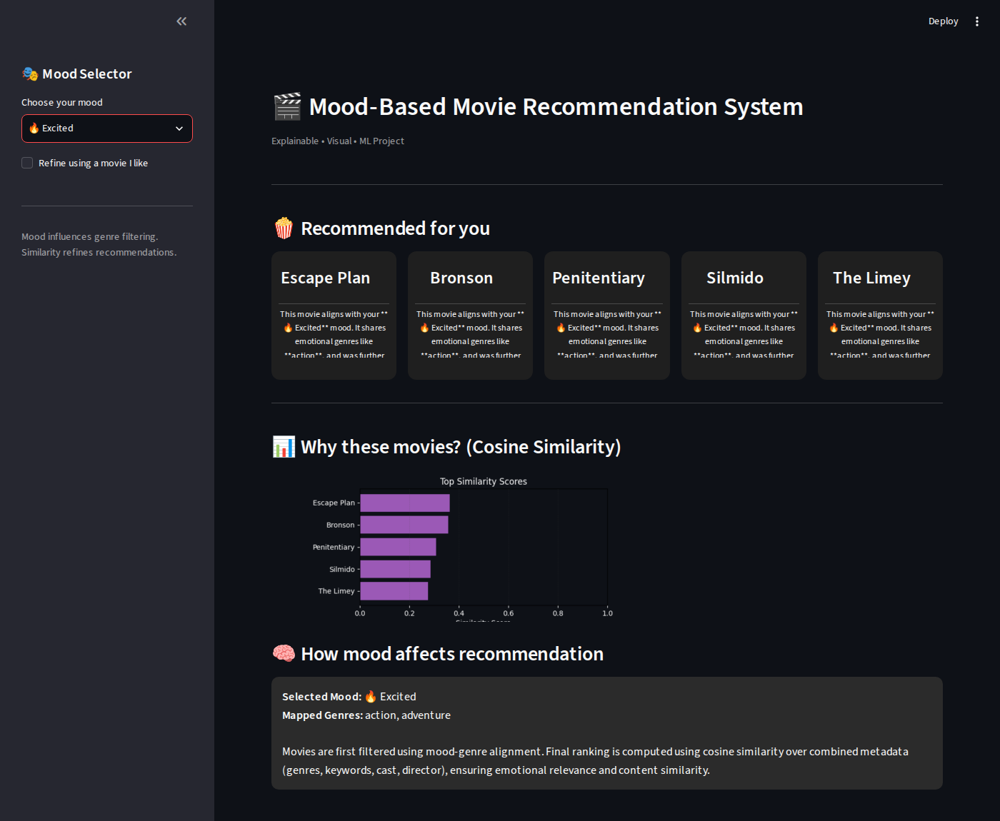
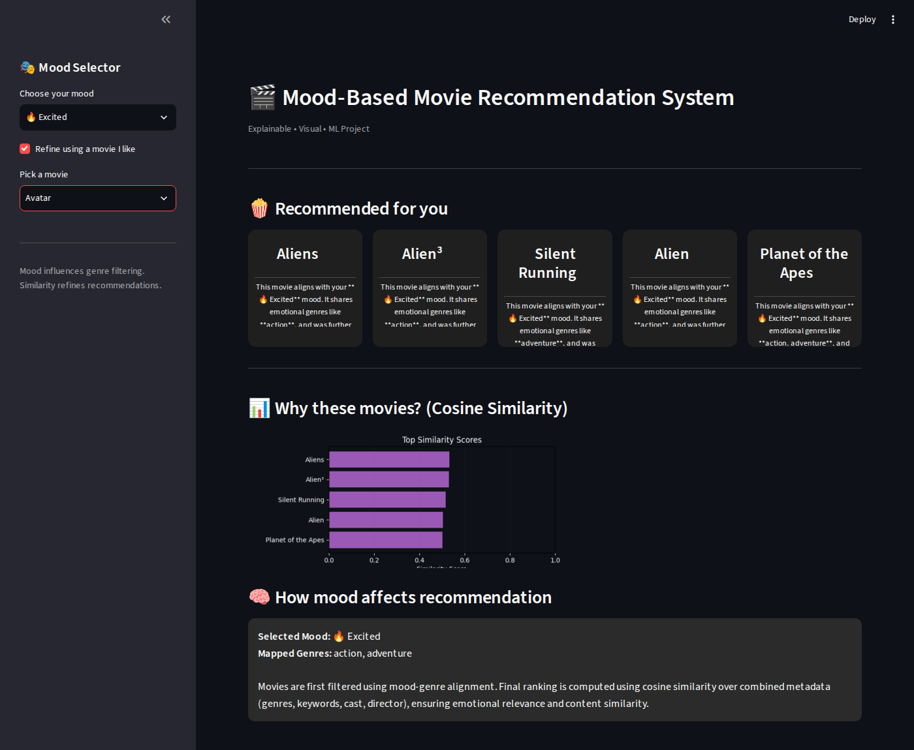

# 🎬 Mood-Based Movie Recommendation System

A content-based movie recommender built with **Streamlit**. Pick your mood, optionally pick a movie you like, and get 5 recommendations with a plain-English explanation of why each one was chosen, plus a chart of the cosine-similarity scores.

## Screenshots

**Default view (mood: Happy)**



**Changing the mood (Excited)**



**Refining with a movie you like (Avatar)**



> The app is styled for Streamlit's **dark theme**. If your system uses light mode, run it with `streamlit run app.py --theme.base dark`.

## How it works

1. **Data**: the [TMDB 5000 Movie Dataset](https://www.kaggle.com/datasets/tmdb/tmdb-movie-metadata) (about 4,800 movies plus credits).
2. **Features**: for every movie, genres, plot keywords, top 3 cast members and the director are combined into one `tags` string.
3. **Vectorization**: `CountVectorizer` (5,000 features, English stop words removed) turns each `tags` string into a vector.
4. **Similarity**: cosine similarity between all movie vectors gives a 4,803 × 4,803 similarity matrix.
5. **Mood filter**: each mood maps to genres, and only movies matching those genres are kept.

| Mood | Genres used |
|------|-------------|
| 😊 Happy | comedy, family |
| 😢 Sad | drama, family |
| 😍 Romantic | romance |
| 🔥 Excited | action, adventure |
| 🕶 Dark | crime, thriller |
| 😌 Relaxed | fantasy |

6. **Ranking**: among the mood-matching movies, the most similar ones to the base movie are shown (the default base movie is *The Shawshank Redemption*).

## Project structure

```
mbmrs/
├── app.py                  # Streamlit web app
├── save_model.py           # Builds movies.pkl and similarity.pkl from the CSVs
├── movie_recommender.py    # Core logic / experiments (runs in the terminal)
├── movies.pkl              # Processed movie data
├── dataset/
│   ├── tmdb_5000_movies.csv
│   └── tmdb_5000_credits.csv
├── screenshots/            # Images used in this README
├── requirements.txt
├── LICENSE
└── .gitignore
```

> `similarity.pkl` (~185 MB) is **not** stored in this repository because it is larger than GitHub's 100 MB file limit. You generate it once with the command below.

## Setup

```bash
# 1. Clone
git clone https://github.com/<your-username>/<your-repo>.git
cd <your-repo>

# 2. Create and activate a virtual environment
python -m venv venv
source venv/bin/activate        # Windows: venv\Scripts\activate

# 3. Install dependencies
pip install -r requirements.txt

# 4. Generate the similarity matrix (one time, takes a minute)
python save_model.py

# 5. Run the app
streamlit run app.py
```

Then open the local URL Streamlit prints (usually http://localhost:8501).

## Tech stack

Python · Streamlit · pandas · scikit-learn · matplotlib

## Possible improvements

- Compute the similarity matrix at startup (or store it as `float16`) so no large file is needed
- Add movie posters via the TMDB API
- Add more moods or let users combine several

## License

This project is licensed under the [MIT License](LICENSE) © 2026 Himanshu Sharma.

## Acknowledgements

Dataset: TMDB 5000 Movie Dataset on Kaggle.
